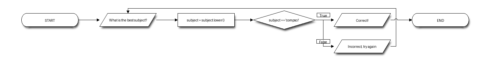

# Flowchart Runner: Demo

Flowchart runner is a program to draw and run flowcharts, you write a flowchart in JSON, and then it can either be drawn to a PNG, or interpreted.

## Download and try

Clone the repo and install the dependencies

```bash
git clone https://github.com/hhhug000/Flowchart-Runner.git
cd Flowchart-Runner
pip install -r requirements.txt
```

You can also install everything at once with no dependencies in a compiled binary from the releases page:


Then make a flowchart (Use the guide in the README) and draw and run it with the below commands:

```bash
python flowchartrunner.py run example.flow.json # Run through the flowchart
python flowchartrunner.py draw example.flow.json -o exampleflowchart # Draw the flowchart to a file named exampleflowchart.png
```

## Non download demo

Whilst you should clone the repo and try for yourself, If you do not have python or don't want to download here is an example

The following flowchart will run as shown, and was defined with the below json:



```
What is the best subject?Maths
Incorrect, try again
What is the best subject?Physics
Incorrect, try again
What is the best subject?CompSci
Correct!
```

```json
{
    "metadata":{
        "name":"Example Flowchart"
    },
    "chart":{
        "start":{
            "type":"terminator",
            "value":"START",
            "lines":[
                "ask"
            ]
        },
        "ask":{
            "type":"io",
            "subtype":"input",
            "value":"What is the best subject?",
            "datatype":"string",
            "variable":"subject",
            "lines":[
                "normalise"
            ]
        },
        "normalise":{
            "type":"process",
            "value":"subject = subject.lower()",
            "lines":[
                "check"
            ]
        },
        "check":{
            "type":"decision",
            "value":"subject == 'compsci'",
            "lines":{
                "True":"correct",
                "False":"incorrect"
            }
        },
        "correct":{
            "type":"io",
            "subtype":"output",
            "value":"Correct!",
            "lines":[
                "end"
            ]
        },
        "incorrect":{
            "type":"io",
            "subtype":"output",
            "value":"Incorrect, try again",
            "lines":[
                "ask"
            ]
        },
        "end":{
            "type":"terminator",
            "value":"END"
        }
    }
}
```

## How do I use it?

Clone the repo and install the dependencies

```bash
git clone https://github.com/hhhug000/Flowchart-Runner.git
cd Flowchart-Runner
pip install -r requirements.txt
```

Then make your own flowchart file, or use an example file

Then run and draw the flowchart

```bash
python flowchartrunner.py run example.flow.json # Run through the flowchart
python flowchartrunner.py draw example.flow.json -o exampleflowchart # Draw the flowchart to a file named exampleflowchart.png
```

## Writing flowcharts

Create a new file and call it `mychart.flow.json`

Then write the following boilerplate

```json
{
    "metadata":{
        "name":"My Flowchart"
    },
    "chart":{}
}
```

Now you can start adding blocks, each block needs an id, type, and value, and some types will require more fields.

For each block add this to the chart section in the file:

```json
"start":{
    "type":"terminator",
    "value":"START",
    "lines":[
        "ask"
    ]
}
```

Every chart needs at lease one start terminator, and (optionally) one end terminator.
This is done with type `"terminator"`, and a value of either `"START"` or `"END"`

Blocks can be connected to other blocks with lines, the lines value is usually a list, but it can also be a dictionary if the block is of type `"decision"`

These are some examples of blocks, which when added to a chart should ask the user for the best subject, and keep asking until the user says compsci, then say Correct, and say Incorrect every time they say something else:

```json
"start":{
    "type":"terminator",
    "value":"START",
    "lines":[
        "ask"
    ]
},
"ask":{
    "type":"io",
    "subtype":"input",
    "value":"What is the best subject?",
    "datatype":"string",
    "variable":"subject",
    "lines":[
        "normalise"
    ]
},
"normalise":{
    "type":"process",
    "value":"subject = subject.lower()",
    "lines":[
        "check"
    ]
},
"check":{
    "type":"decision",
    "value":"subject == 'compsci'",
    "lines":{
        "True":"correct",
        "False":"incorrect"
    }
},
"correct":{
    "type":"io",
    "subtype":"output",
    "value":"Correct!",
    "lines":[
        "end"
    ]
},
"incorrect":{
    "type":"io",
    "subtype":"output",
    "value":"Incorrect, try again",
    "lines":[
        "ask"
    ]
},
"end":{
    "type":"terminator",
    "value":"END"
}
```

This flowchart will run something like this:
```
What is the best subject?Maths
Incorrect, try again
What is the best subject?Physics
Incorrect, try again
What is the best subject?CompSci
Correct!
```

And when drawn will produce this image:


